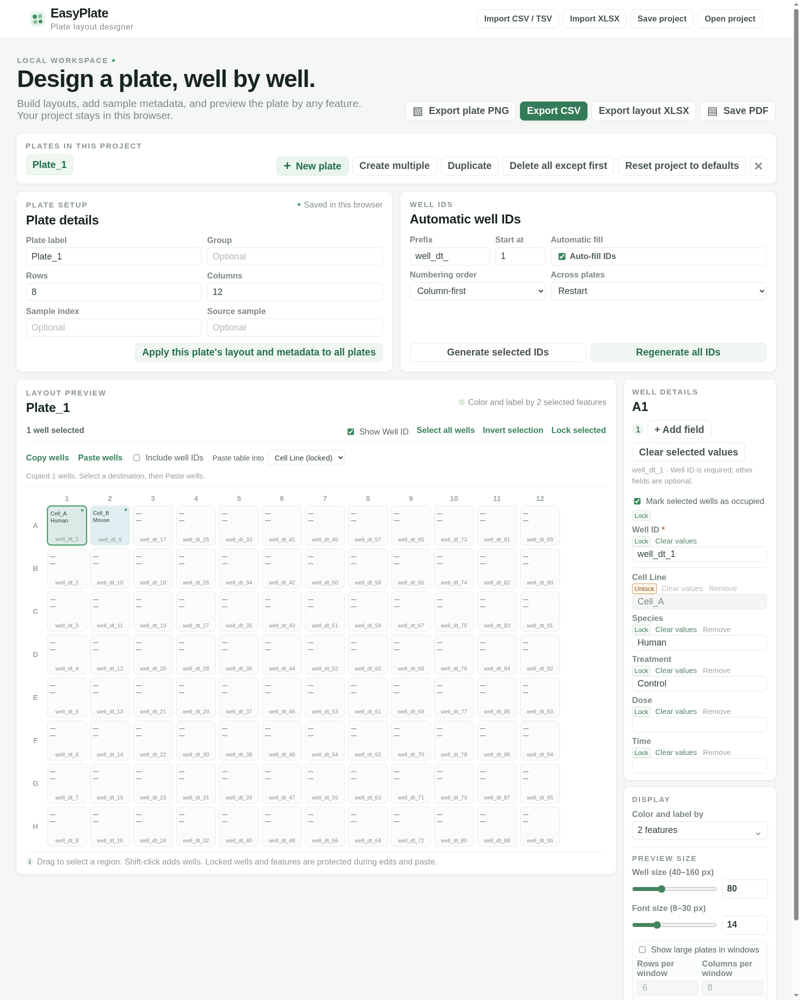

# EasyPlate

EasyPlate is a local browser tool for planning sample plate layouts, assigning well metadata, and exporting plate annotations and maps. It serves only on `127.0.0.1`; imported table contents are processed on this computer.

Windows users can install EasyPlate from the [Microsoft Store](https://apps.microsoft.com/detail/9nvdvzllfj57).



*EasyPlate v0.1.3 with a 96-well example plate, a locked feature, and copy/paste controls.*

## Requirements

To run EasyPlate from its source code, you need:

- Python 3.10 or newer (`python3` on macOS/Linux or `python` on Windows).
- A current browser with JavaScript enabled, such as Safari, Edge, Chrome, or
  Firefox.
- Bash only for the `start.sh` convenience launcher on macOS/Linux. Windows
  can run `server.py` directly from PowerShell.

The browser runs `app.js` and `xlsx.js` for plate editing, import, and export; no separate
JavaScript installation is needed. The local server uses only Python's standard
library. It does not need `pip`, a virtual environment, Node.js, or npm to run.
Git is needed only if you clone the repository rather than download it as a ZIP
file.

## Quick setup

### macOS

To run the cloned source, check your Python version with `python3 --version`.
If it is missing or older than 3.10, install a current Python with
[Homebrew](https://brew.sh/):

```bash
brew install python
```

You can also use the [official Python macOS installer](https://docs.python.org/3/using/mac.html).

### Install with Homebrew on macOS

To install the packaged command, use the separate
[EasyPlate Homebrew tap](https://github.com/FupaulHuang/homebrew-easyplate):

```bash
brew tap FupaulHuang/easyplate
brew trust --formula FupaulHuang/easyplate/easyplate
brew install FupaulHuang/easyplate/easyplate
easyplate
```

Homebrew installs Python 3.12 as the package's managed default. EasyPlate also
works with other Python versions from 3.10 onward. To use one you already
have, set `EASYPLATE_PYTHON` to its executable, for example:

```bash
EASYPLATE_PYTHON=/path/to/python3.11 easyplate
```

The Homebrew package still installs its Python 3.12 dependency. To stop
EasyPlate, press `Ctrl+C` in its terminal. To uninstall the package:

```bash
brew uninstall FupaulHuang/easyplate/easyplate
```

To also remove the formula's trust and the tap:

```bash
brew untrust --formula FupaulHuang/easyplate/easyplate
brew untap FupaulHuang/easyplate
```

### Ubuntu 22.04+ or Debian 12+ Linux

On a Linux desktop with a current browser, install the command-line tools if
they are missing:

```bash
sudo apt update
sudo apt install python3 bash git
python3 --version
```

For another Linux distribution, use its package manager to install Python
3.10+ and Bash. Check the result with `python3 --version`.

### Clone and run on macOS or Linux

After Python is installed on macOS or Linux:

```bash
git clone https://github.com/FupaulHuang/EasyPlate.git
cd EasyPlate
bash start.sh
```

### Install from Microsoft Store on Windows

Open [EasyPlate in the Microsoft Store](https://apps.microsoft.com/detail/9nvdvzllfj57),
install the app, then launch **EasyPlate** from the Windows Start menu. It opens
the local interface in your browser.

The Store app includes its Python runtime, so you can install and run it without
setting up Python separately. A current browser with JavaScript enabled is
still required.

### Run the source on Windows (PowerShell)

Install Python 3.10 or newer using the [official Python Windows instructions](https://docs.python.org/3/using/windows.html).
Then run these commands in PowerShell (`git clone` requires Git; you can also
download and extract the repository ZIP):

```powershell
python --version
git clone https://github.com/FupaulHuang/EasyPlate.git
cd EasyPlate
python server.py
```

EasyPlate opens `http://127.0.0.1:8765` in your default browser. Keep
PowerShell open while using it; press `Ctrl+C` to stop the server. If the
browser does not open, enter that address manually. If `python` is unavailable
but the Windows Python launcher is installed, use `py -3 server.py` instead.

## Start from an existing project folder

On macOS or Linux, run:

```bash
bash start.sh
```

On Windows, run `python server.py` from PowerShell instead. Both commands
ask the default browser to open the page. Keep the terminal open while using
EasyPlate; press `Ctrl+C` there to stop it. No internet connection is needed
after setup.

To choose another port, run `bash start.sh --port 8766` on macOS/Linux or
`python server.py --port 8766` on Windows. The browser opens
`http://127.0.0.1:8766`. The installed `easyplate` command also accepts
`--port 8766`. Use `python server.py --no-browser` to start without opening
a browser.

If several Python versions are installed on macOS or Linux, `start.sh` uses
`python3` by default. Select a different Python 3.10+ executable with
`EASYPLATE_PYTHON=/path/to/python3.11 bash start.sh`. The launcher checks the
version before starting the server.

If the browser does not open automatically, open `http://127.0.0.1:8765` on
the same computer. `127.0.0.1` refers to that computer only.

## Create and edit plates

Text entered in plate labels, groups, sample details, well IDs, metadata values,
and new feature names accepts English letters, numbers, `_`, and `-`. Other
characters (including spaces and decimal points) become `_`, with an
**invalid input** warning. For example, `Drug A/1.5` becomes `Drug_A_1_5`.
The same rule applies to copied, pasted, and imported values. Existing projects
in browser storage are preserved until values are edited or imported.

- Use **New plate** or **Duplicate** to add a plate. Set its label, group, dimensions, sample index, and source sample in **Plate details**.
- Use **Create multiple** to add several blank plates at once with generated labels. **Delete all except first** keeps the first plate unchanged and removes the others. **Reset project to defaults** restores one blank plate and the default fields. **Apply this plate's layout and metadata to all plates** copies its well layout and values to the other plates while retaining their labels and source details.
- New plates use 8 rows × 12 columns by default. The editor supports 1–40 rows and 1–48 columns.
- Automatic well ID fill is enabled by default and assigns an ID to every well, starting with `well_dt_1`. Turning **Auto-fill IDs** off clears IDs from every well; turning it on fills missing IDs across the project. Select wells and use **Generate selected IDs** to generate IDs using the configured prefix and start number, skipping IDs already in use. **Regenerate all IDs** replaces IDs across the project after confirmation. **Column-first** numbers down rows before moving across columns; **Row-first** numbers across columns before moving down rows. Choose whether numbering restarts or continues across plates. Well ID is always present in **Well details** for manual editing.
- **Plate Setup** stays on the left and **Well IDs** on the right through laptop-sized windows; they stack on narrow screens. The panels have matching spacing, while Well IDs gives shorter inputs to Prefix and Start at and wider space to numbering controls.
- Select wells in **Layout Preview** and choose **Lock selected** to protect their IDs, occupancy, and metadata. An amber border marks each locked well. Select locked wells and choose **Unlock selected** to edit them again. Edits to a mixed selection apply only to unlocked wells; bulk clear, paste, and ID generation also skip locked wells. Unlock wells before deleting them, removing a metadata field, resetting the project, or replacing it with another project. Locks are saved in the project JSON.
- Use **Lock** beside a feature in **Well Details** to protect that feature across every well on every plate. **Unlock** makes it editable again. This includes Well ID and occupancy. Editing, clearing, table paste, and copying preserve locked features. Unlock features before removing them, shrinking or deleting plates, copying a complete layout over other plates, resetting, or replacing the project. Feature locks are saved in JSON and new XLSX exports.
- **Well Details** sits beside Layout Preview, with the **Display** panel below it. Well ID and occupancy remain visible above the metadata fields. When there are more than five metadata features, the list shows about five at a time; use its scrollbar to reach the rest. **Clear selected values** clears the selected wells' ID, barcode, occupancy, and metadata. If automatic fill is on, IDs are assigned again to those wells.
- **Invert selection** toggles every well in the visible window. In windowed view, selections in other windows are preserved.
- **Select all wells** selects every well on the current plate, including wells in other windows. When all wells are selected, the button becomes **Deselect all wells**.
- Select a well or drag over a rectangular region. Shift-click adds or removes individual wells. Edit the well ID and active metadata fields in **Well details**. **Clear values** beside a field clears only that feature across every well; **Remove** deletes an optional feature and its values. **Add field** creates a new optional metadata field. Clearing Well ID values turns Automatic fill off so IDs stay cleared.
- A barcode or assigned metadata marks a well occupied; a generated well ID alone does not. Use the occupancy checkbox to mark planned wells occupied or clear metadata-only occupancy.
- Choose one or more fields under **Color and label by** to color and label by a single field or a combination. Well cells and exported layout figures show values without repeating feature names; the two-second hover card shows field names with their values for every active feature.
- Use **Show Well ID** in Layout Preview to toggle the ID caption beneath each well; PNG and PDF layouts follow this setting. Hover details continue to include the Well ID.
- New projects start with **Cell line** and **Species** as the selected display features. Replicate and Test are not default fields. Barcode can be added when needed. **Select all** includes every feature and toggles to **Deselect all**; clicking again clears the display selection.
- Adjust **Well size** (40–160 px) and **Font size** (8–30 px) under **Preview size** using either the sliders or exact-number inputs. Turn on **Show large plates in windows** to page through row/column sections; choose how many rows and columns each window shows. PNG export uses the current window, and PDF export creates a page for each window.
- The interface and default plate label font are scaled 1.5× larger; existing default font settings are upgraded while user-adjusted larger sizes are retained.
- To copy wells, select one or more wells and click **Copy wells**, select a destination, then click **Paste wells**. One copied well fills every selected destination. With several copied wells, a single destination anchors their original shape; an equal number of selected destinations receives the values in row order. Copying works between plates. **Include well IDs** also copies source IDs; leave it unchecked to retain destination IDs. Locks on the destination remain in force.
- To paste from Excel, choose **Paste table into**, click the starting well, and press **Ctrl+V** (Windows/Linux) or **Cmd+V** (macOS). Tab-separated columns and newline-separated rows retain their grid shape, including blank cells. A single column can fill a selection in numbering order. A table with headers such as `plate_position`, `well_id`, `cell_line`, `species`, `dose`, and `time` updates matching fields; explicit row/column positions take priority over IDs. Locked or out-of-range targets are skipped and reported. **Ctrl/Cmd+C** copies selected wells for pasting within EasyPlate and places the chosen feature's values on the system clipboard for other applications.

## Import

- **Import CSV / TSV** reads a delimited metadata table. Headers such as `plate_id`, `plate_position`, `well_id`, `barcode`, `cell_line`, `species`, `compound`, `dose`, `time`, `x`, and `y` are recognized; `compound` maps to **Treatment**. Tables grouped by `plate_id` become separate plates. A supplied `well_name_label` is ignored because the name is generated from active metadata.
- **Import XLSX** opens a worksheet chooser. Select **Well data** from an EasyPlate export to restore all annotations and saved locks, or select a layout sheet from a new export to import its displayed values. Keep one line per displayed feature in layout cells; use Well data for more extensive edits. In older exports (v0.1.2), use Well data when multiple features were displayed.
- Choose **Add as new plates**, **Replace project**, or **Paste into current plate**. Replacement requires unlocking the current project's wells and features. Pasting into existing wells preserves their locks. Plain worksheets import as grids using **Paste table into**; header tables use their column names. Workbooks edited in Excel or LibreOffice are supported. Formula cells import their saved results, so recalculate and save before importing.
- XLSX import needs a current browser and accepts files up to 64 MB, with up to 64 MB of uncompressed workbook contents. The app's plate limit is 40 rows by 48 columns. A workbook stays on this computer during import.

## Export and project saving

- **Export CSV** downloads `plate_layout_annotations.csv`, with one row per physical position (including empty positions), the reference annotation columns, and every active feature that has at least one value, whether or not that feature is displayed in the figure. It also generates `well_name_label` by joining each well's nonempty active metadata values with `_`, excluding Well ID. Optional feature columns and `group`, `sample_index`, or `source_sample` are omitted individually when empty (`None`/`NA`) across the whole project; missing cells in retained columns are exported blank. The current display selection does not affect CSV columns.
- **Export plate PNG** downloads a high-resolution image of the current plate window with selected feature text wrapped in each well.
- **Export layout XLSX** downloads an editable workbook with a colored layout sheet for each full plate and a **Well data** sheet containing individual well values. Layout colors and displayed labels follow the current preview; amber borders mark wells locked in EasyPlate. A hidden information sheet preserves feature locks, display settings, and layout mappings. Keep it when editing. The layout and Well data sheets can be edited independently; use **Import XLSX** and select the sheet you edited to apply those changes.
- **Save PDF** opens a print-ready view. Large plates are paged into manageable row/column sections; when many features are selected, the PDF splits them into feature groups so labels and values remain visible. In the browser print dialog, choose **Save as PDF**.
- **Save project** downloads a JSON copy. **Open project** restores one. The current project also autosaves in browser storage for this local address.

The CSV export reports repeated or missing well IDs before downloading and lets you decide whether to continue. The generated default ID order runs down rows in each column, matching the supplied workbook layout.

## Project files

`index.html`, `styles.css`, `app.js`, and `xlsx.js` are the browser interface. `server.py`
serves them on this computer; `start.sh` launches the server and opens a
browser on macOS/Linux. See [AGENTS.md](AGENTS.md) for AI agent run instructions.
Keep real sample metadata and exported projects out of the repository; use
invented or anonymized examples instead.

## License

EasyPlate is released under the [MIT License](LICENSE).
